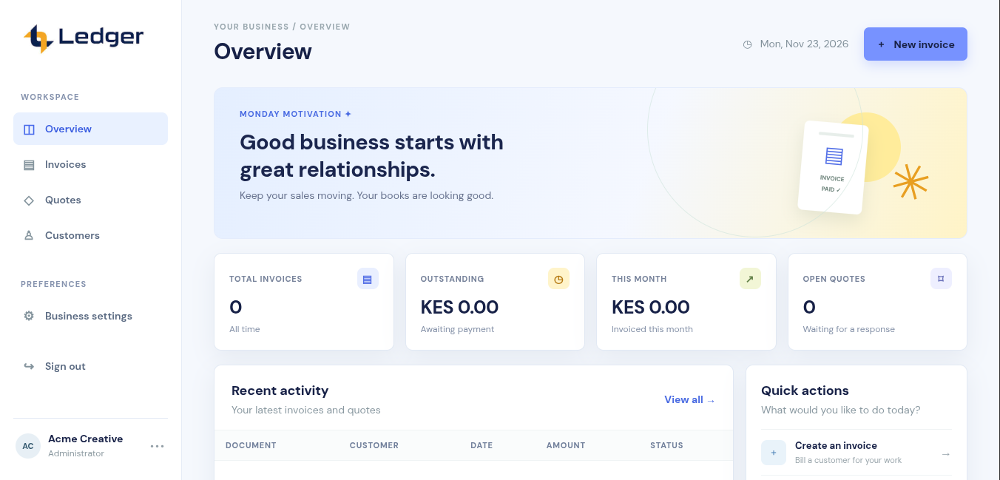
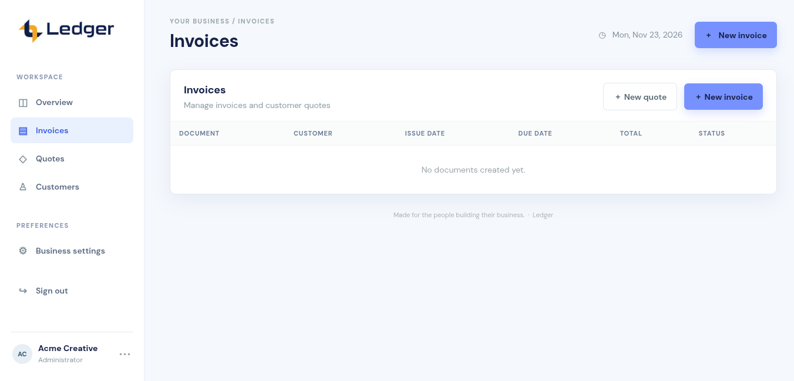
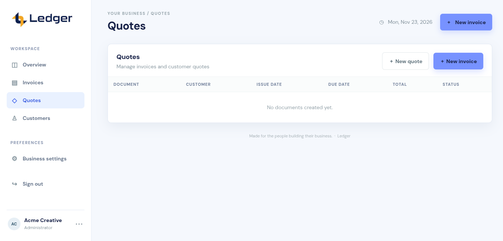
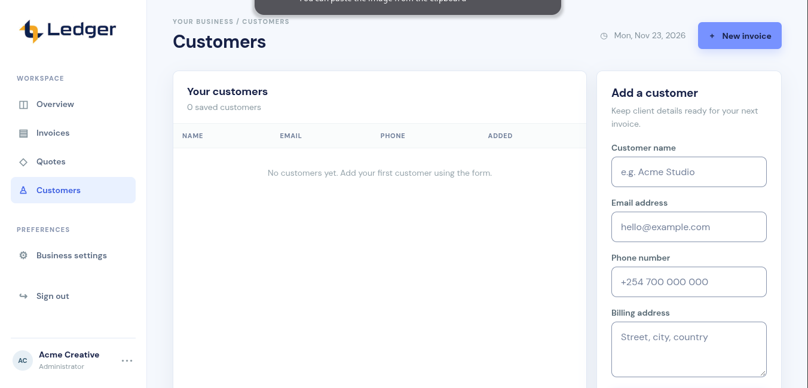
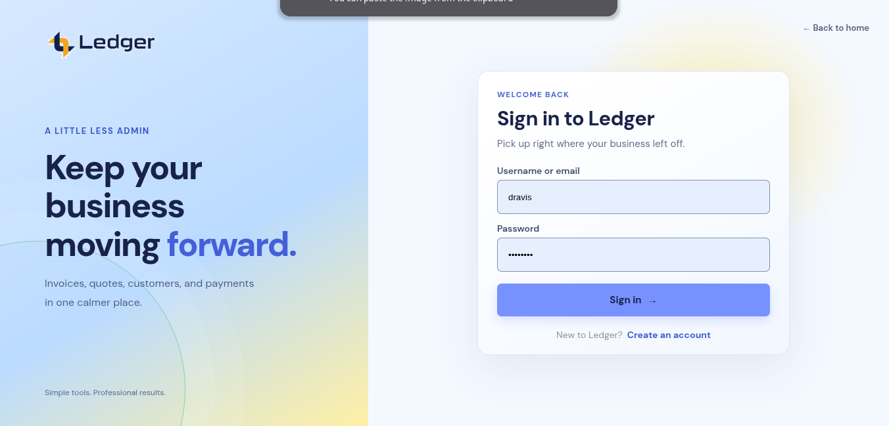

# Ledger — Sales Invoicing

Ledger is a small-business invoicing app built with PHP, MySQL, and Apache. Create customer records, prepare invoices and quotes, track payments, and print clean sales documents.

## Product tour

The public homepage explains the product and includes an interactive sign-in and registration card. Visitors can switch between the welcome, sign-in, and one-time workspace owner setup views without leaving the page.


### Overview dashboard

The dashboard summarizes invoice volume, outstanding balances, monthly sales, and open quotes. Recent documents and shortcuts to the main tasks are available below the summary cards.



### Invoices and quotes

Invoices and quotes have separate lists. Create either document with customer details, multiple item rows, quantities, prices, tax, and notes. An accepted quote can be converted into an invoice.





### Customers

Keep customer names, contact information, and billing addresses ready for new sales documents.



### Sign in

The sign-in page is available directly at `/login`. The homepage card switches to this form when a visitor selects sign in.



### Business branding and customer certificates

Add a business logo and contact details during owner registration, then update them any time from **Settings**. You can also upload or replace a business verification document; it is stored privately and is only available to signed-in workspace users. The workspace owner can issue a customer certificate from the customer list and download it as a formatted PDF.

## Features

- Dashboard with invoice totals, monthly sales, outstanding balances, and open quotes
- Customer directory with international phone normalization
- Invoices and quotes with multiple line items and configurable tax rates
- Automatic invoice and quote numbering
- Quote-to-invoice conversion
- Full and partial payment tracking
- Formatted PDF downloads for invoices, quotes, sales reports, and customer certificates (Dompdf)
- **WhatsApp Integration (Cerebro API & Baileys):**
  1. **Manual WhatsApp Dispatch:** One-click invoice sending from the document view with prefilled, editable message templates and international phone number formatting.
  2. **FIFO Message Queueing:** Dedicated First-In-First-Out message queue (`whatsapp_queue`) ensuring sequential dispatch and decoupling document creation from external network latencies.
  3. **Automated Scheduling of Invoices:** Future timestamp dispatch (`POST /messages/schedule`) for scheduled payment reminders and upcoming due date notices.
  4. **Integration Settings Management:** Workspace configuration in Business Settings for Cerebro API URL, API keys (`X-API-Key`), automated creation-time queueing, and custom template merge tags.
- Business profile with logo and contact details on invoices and certificates
- Private business verification document upload and download
- Customer certificates with unique certificate numbers
- Single-owner registration with password hashing
- KES currency by default, configurable through `APP_CURRENCY`

## Deploy the web server

On Debian or Ubuntu, run:

```bash
./deploy_webserver.sh
```

The script checks and installs Docker Engine, Docker Compose, and host utilities when needed. The project runs PHP with **Apache** in its web container and MySQL in a separate persistent container, so it does not install a second host web server. It creates a private `.env` with a generated recovery password when needed, selects an available port, builds and starts the stack, waits for MySQL, and checks that the homepage responds over HTTP. If UFW or firewalld is active, it adds an allow rule for the selected TCP port. On setup errors, it prints Compose status and recent service logs to help diagnose the problem.

At completion, the script prints the local URL, a LAN URL, and a public-IP URL when it can detect one. External access still depends on the host having a reachable public address. If the server is behind a router or carrier NAT, forward the displayed TCP port to the server or use a public tunnel/domain. The public-IP URL uses HTTP; configure HTTPS before using it for production.

After the first start, open the printed link and create the workspace owner account on the homepage or at `/register`.

## Preview on Windows

Install and start Docker Desktop first, with its Linux container engine running. From File Explorer, double-click [`run_windows.bat`](run_windows.bat), or run `powershell -NoProfile -ExecutionPolicy Bypass -File .\run_windows.ps1` in PowerShell from the project directory. The launcher checks Docker Compose, starts Docker Desktop if it is installed but closed, creates local settings if needed, chooses an available port, builds the containers, waits for MySQL and the homepage, then opens the preview in your browser. It prints the sign-in and owner-setup links and the local recovery credentials in the console. The batch window stays open so you can read them.

If Docker Desktop is missing, the launcher opens its download page and explains what to do. Stop the app with `docker compose down`; the MySQL Docker volume and its data are kept.

For manual development, install Docker Engine and Compose, copy `.env.example` to `.env`, set `APP_PASSWORD`, then use `docker compose up --build`. By default the web app is at [http://localhost:8081/](http://localhost:8081/); set `APP_PORT` in `.env` to select another port.

MySQL data persists in the `mysql_data` Docker volume. Business logos and verification documents persist in the private `uploads_data` Docker volume, outside the web document root. Back up both volumes to preserve all app data and uploaded files. Tables are initialized on the first app request. The environment credentials (`admin` / `change-me-now` by default) remain available as a local recovery login; the deployment script replaces the sample app password with a generated value. Change the database passwords before sharing or deploying the app.

## Routes

- `/` — public product page and in-page sign-in/registration card
- `/login` — sign-in
- `/register` — one-time workspace owner setup
- `/dashboard` — business overview
- `/invoices` and `/quotes` — document lists
- `/customers` — customer directory
- `/new?type=invoice` or `/new?type=quote` — create a document
- `/document/{id}` — view, print, convert, or record payment
- `/document/{id}/pdf` — download a formatted invoice or quote PDF
- `/reports` and `/reports/pdf` — view and download the sales report
- `/certificate/{customer-id}/pdf` — download an issued customer certificate
- `/whatsapp-queue` — view, monitor, and process the FIFO WhatsApp dispatch queue
- `/settings` — business settings and WhatsApp integration configuration

## Architecture and network guide

See [`docs/ARCHITECTURE.md`](docs/ARCHITECTURE.md) for the full request path and route/action reference, dashboard-to-MySQL flow, Docker image and service configuration explained line by line, Apache/static/private media behavior, volume persistence and backups, optional Nginx reverse proxy design, and a Kubernetes scaling plan. It distinguishes the current Apache + Docker Compose deployment from Nginx and Kubernetes components that would be added later.

## Project notes

The descriptive screenshots in [`screenshots/`](screenshots/) are embedded above using repository-relative Markdown paths. Keep that folder when pushing the project so GitHub can render the images in this README. The app currently uses a shared, single-owner workspace; multi-business data separation, team roles, email delivery, and inventory are not implemented. The uploaded Ledger logo and supplied blue, light-blue, yellow, and orange palette are used in the interface.
