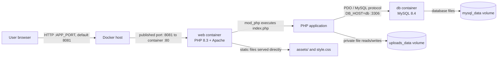
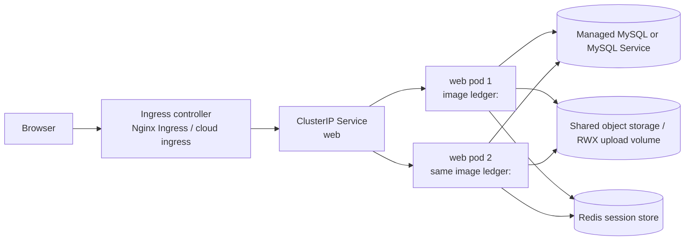

# Ledger architecture and deployment guide

This guide describes the implementation in this repository and how it can be extended. The Compose setup is the current deployment. Nginx and Kubernetes sections describe optional deployment patterns; those components are not currently installed or configured by this project.

## 1. Current request and network path



1. A browser opens `http://<host>:<APP_PORT>/`. Compose publishes the host port (8081 by default) to port 80 in the `web` container.
2. Apache receives the HTTP request. `mod_rewrite` is enabled in the image. `.htaccess` serves existing files such as `/style.css` and `/assets/...` directly; paths that are not files or directories are rewritten to `index.php`.
3. `index.php` parses the URL path, checks the session and CSRF token where relevant, reads or changes data through PDO, then renders HTML or a PDF response. This is a server-rendered PHP application: the browser does not call a separate JSON API for the dashboard.
4. PDO resolves `DB_HOST=db` using Docker Compose's internal DNS. The connection goes to MySQL port 3306 on the private Compose network. Port 3306 is not published to the host in the current Compose file.
5. Apache returns the generated response through the published port. Images, CSS, and other existing files in the project are returned by Apache as static files.

The browser's network connection is to the Docker host's published web port. The PHP-to-MySQL connection is internal to Docker. The browser never connects directly to MySQL or to the upload volume.

PHP starts a server-side session at the beginning of each request. The browser stores only the session identifier in its cookie; PHP reads the session contents on later requests. Under the current single-container Compose setup, session files are local to the web container. For multi-replica Kubernetes, move sessions to a shared service such as Redis.

## 2. Services and images

### `web` service

`web` is built from the local `Dockerfile`. The final image uses `php:8.3-apache`, so Apache and PHP run in the same container. PHP is integrated with Apache, and Apache executes `index.php` for routed requests. It is not a separate PHP-FPM service.

The Dockerfile has two build stages:

1. `FROM composer:2 AS vendor` copies `composer.json` and installs production PHP libraries into `/app/vendor`. Dompdf and its dependencies are installed here. There is currently no committed `composer.lock`, so Composer resolves compatible versions while building; commit a lock file for repeatable production builds.
2. `FROM php:8.3-apache` creates the runtime image, installs/enables the PDO MySQL, DOM, mbstring, and GD extensions, enables Apache's `rewrite` and `headers` modules, copies in the PHP settings, Composer vendor directory, application files, and entrypoint.

Only the final PHP/Apache image runs as the `web` service. The Composer stage is a build-time stage, not a running service. Docker Compose builds one app image and starts a container from it. The MySQL service uses the upstream `mysql:8.4` image; it is a separate image and container with a different purpose.

### `db` service

The `db` service runs MySQL 8.4. Its database files live in the `mysql_data` named volume. Compose starts the web service only after MySQL's health check reports healthy. The health check runs `mysqladmin ping` inside the database container; it does not expose MySQL to the public network.

### Why there are not two copies of the app

The `web` container uses the project source and dependencies. The `db` container uses a MySQL image and stores relational data. They are not duplicate copies of the same app. In a scaled deployment, multiple `web` containers can all use the *same tagged app image* and source revision. A load balancer chooses one healthy web replica for each incoming request. The database should not be duplicated by starting independent MySQL containers against the same data directory; use one database service or a database cluster designed for replication.

## 3. Compose configuration, line by line

The file is [`docker-compose.yml`](../docker-compose.yml).

### Web service

- `build: .` — build the app image from the repository's `Dockerfile`.
- `ports: "${APP_PORT:-8081}:80"` — publish host TCP port `APP_PORT` (8081 by default) to Apache's port 80 in the container. The current mapping binds on all host interfaces. This is why the app is reachable from other machines when host firewall and network routing permit it.
- `DB_HOST: db` — use Compose's service name as the internal DNS hostname for MySQL.
- `DB_NAME`, `DB_USER`, `DB_PASSWORD` — PDO connection settings. The current Compose file hard-codes the database password. To change it, change `web.DB_PASSWORD` and the matching `db.MYSQL_PASSWORD` together; change `MYSQL_ROOT_PASSWORD` too. Do not assume an environment change rotates credentials in a MySQL volume that was already initialized.
- `APP_CURRENCY` — default currency displayed by PHP; `KES` if unset.
- `APP_STORAGE_PATH: /var/www/private_uploads` — directory used by PHP for private uploaded files.
- `APP_USERNAME` / `APP_PASSWORD` — environment-based recovery login. The owner account created in the application is stored in MySQL and uses a password hash.
- `depends_on: db: condition: service_healthy` — wait for the MySQL health check before starting the web container. PDO still handles a database connection failure with a service-unavailable response.
- `./:/var/www/html` — bind-mount the checked-out project over the app's document root. This makes local source edits visible without rebuilding. In production, consider removing this mount and running the code baked into the immutable image.
- `/var/www/html/vendor` — anonymous volume keeps Composer dependencies supplied by the image from being hidden by the source bind mount.
- `uploads_data:/var/www/private_uploads` — persistent named volume for logos and verification documents. It is outside Apache's document root and isn't served as a public static directory.

### Database service and named volumes

- `image: mysql:8.4` — use the official MySQL 8.4 image.
- `MYSQL_DATABASE`, `MYSQL_USER`, `MYSQL_PASSWORD`, `MYSQL_ROOT_PASSWORD` — MySQL initializes its database and account on the first startup of a fresh data volume. Changing these values later does not rewrite credentials already stored in the data directory.
- `mysql_data:/var/lib/mysql` — persist the database files beyond the life of a container.
- `healthcheck` — Compose polls MySQL readiness and uses the result for `depends_on`.
- `mysql_data:` and `uploads_data:` — declare Docker-managed named volumes. They are independent of container lifetimes and survive `docker compose down`; `docker compose down -v` deletes them and their data.

The current Compose file does not define a custom network. Compose automatically creates a project network and attaches both services to it. Their default service DNS names are `web` and `db`. `web` can reach `db:3306`; other machines cannot resolve those service names.

## 4. Dockerfile and entrypoint settings

The file is [`Dockerfile`](../Dockerfile).

- Composer build stage — installs the PHP library dependencies without requiring Composer in the production runtime container.
- PHP/Apache runtime stage — supplies the web server, PHP runtime, and PHP extensions used by the application and Dompdf.
- `a2enmod rewrite headers` — turns on the modules used by `.htaccess` routing and response headers.
- `COPY php.ini ...` — loads [`php.ini`](../php.ini), including upload limits, memory limit, and maximum execution time.
- `COPY docker-entrypoint.sh ...` — installs the startup script into the image.
- `COPY --from=vendor /app/vendor ./vendor` — copies the generated Composer libraries from the build stage.
- `COPY . /var/www/html/` — copies the app into Apache's document root. Compose's source bind mount overlays this path during local/deployment Compose runs.
- `chown ... www-data` — sets ownership for the app files and image's upload directory.
- `EXPOSE 80` — documents the container's HTTP port; Compose's `ports` entry performs the actual host publishing.
- `ENTRYPOINT` and `CMD` — run the upload preparation script, then start Apache in the foreground so Docker can supervise it.

[`docker-entrypoint.sh`](../docker-entrypoint.sh) creates the configured upload directory and sets it to owner `www-data`, mode `750`, before Apache starts. This is needed because a named volume can have ownership that differs from the image directory. PHP workers run as `www-data`, so they can save files there while other container users cannot list the directory. The script then `exec`s Apache so Apache is the main container process and receives stop signals correctly.

[`php.ini`](../php.ini) sets `upload_max_filesize=16M`, `post_max_size=20M`, `max_file_uploads=10`, `memory_limit=256M`, and `max_execution_time=60`. Application checks impose narrower limits: 5 MB for logos and 15 MB for verification documents.

## 5. URL routes and form actions

These are browser routes handled by the PHP front controller, not a separately versioned REST API. Except for public homepage/sign-in/registration, application pages require a logged-in session. Mutating forms include a CSRF token.

| Method and URL | Purpose and application behavior |
|---|---|
| `GET /` | Public product homepage and embedded sign-in/registration card. |
| `GET /login` | Standalone sign-in form. `POST /login` verifies the workspace user's password hash or the configured recovery credentials, then creates an authenticated PHP session. |
| `GET /register` | One-time workspace owner form. `POST /register` validates the owner and business details, optionally stores a logo and verification file, inserts the user/profile, then signs the owner in. |
| `POST /logout` | Destroys the current session and redirects to sign-in. |
| `GET /dashboard` | Queries invoice totals, outstanding balance, current-month invoices, sent quote count, and the six newest documents; PHP renders the dashboard. |
| `GET /invoices` | Lists invoices (the route sets the document type filter to invoice). |
| `GET /quotes` | Lists quotes (the route sets the document type filter to quote). |
| `GET /documents` | Lists documents without the invoice/quote route's forced filter. |
| `GET /customers` | Lists customers and certificate status. `POST /customers` with action `customer` creates a customer. |
| `GET /new?type=invoice` | Displays the invoice form. `GET /new?type=quote` displays the quote form. `POST /new` with action `document` creates a document and its line items in a database transaction. |
| `GET /document/{id}` | Displays a saved document and items. `POST` action `convert` converts a quote into an invoice; action `payment` updates invoice paid amount and payment status. |
| `GET /document/{id}/pdf` | Reads a document and its lines, renders a formatted PDF with Dompdf, and downloads it. |
| `GET /reports` | Queries invoice count, invoiced, collected, outstanding, and monthly invoice totals. |
| `GET /reports/pdf` | Runs the report queries and downloads the formatted PDF report. |
| `POST /customers` with action `issue_certificate` | Issues one certificate per customer and stores its number and customer/business name snapshot in MySQL. |
| `GET /certificate/{customer-id}/pdf` | Reads the issued certificate and downloads a formatted certificate PDF. |
| `GET /settings` | Displays business profile and verification upload status. `POST /settings` with action `profile` changes profile details/logo/verification upload. |
| `GET /media/logo` | Authenticated route that reads the private logo from the upload volume and returns it inline for the invoice/profile UI. |
| `GET /media/verification` | Authenticated route that reads the private verification file and returns it as an attachment. |
| `GET /style.css`, `GET /assets/...` | Existing static files served directly by Apache, not database-backed media. |

The form's `action` field selects a PHP operation; the URL alone isn't a complete description of the operation. The app uses `POST`/redirect/`GET` for successful writes so a page refresh doesn't repeat the form submission.

## 6. How the dashboard and features use MySQL

`index.php` opens one PDO connection per web request. Connection values come from environment variables; in Compose, `DB_HOST=db` means the app uses Docker's internal network and not `localhost`. MySQL listens on its container port 3306. PDO uses prepared statements for values originating in forms and URL identifiers.

On each request, the app currently issues `CREATE TABLE IF NOT EXISTS` statements for `users`, `customers`, `documents`, `document_items`, `business_profiles`, and `certificates`; it also seeds the default business profile if needed. The dashboard queries `documents` for invoice count, outstanding balance, and current-month invoiced amount; counts sent quotes; and joins recent documents to `customers` for display. The browser receives already-rendered HTML. The JavaScript on the new-document form calculates a live preview of totals in the browser, while PHP recalculates and saves the authoritative amounts on submission.

Core relationships:

- `documents.customer_id` points to `customers.id`; deleting a customer leaves the document but clears the customer reference.
- `document_items.document_id` points to `documents.id`; deleting a document deletes its lines.
- `certificates.customer_id` points to `customers.id`; each customer can have at most one certificate in this app, and deleting a customer deletes the certificate.
- `business_profiles` is a single shared workspace profile (`id=1`), because the product is currently single-workspace/single-owner rather than multi-tenant.
- Profile tables store generated upload names and MIME types. The file bytes stay in the upload volume, not in MySQL.

The schema is initialized inline and idempotently, but this project does not yet have a separate schema migration tool. For upgrades that change columns or data, add versioned migrations and apply them before rolling out multiple app replicas.

## 7. Media, PDF generation, and persistence

### Uploaded files versus static images

The logo and verification document are uploaded through multipart forms. PHP checks upload status, size, MIME type, and image dimensions, then generates a random filename and writes it to `APP_STORAGE_PATH`. The original filename is retained only as display metadata. The directory `/var/www/private_uploads` is mounted to `uploads_data`, outside `/var/www/html`; Apache's normal static-file handling therefore cannot expose its contents by guessing a URL.

Compose sets `APP_STORAGE_PATH` to the mounted volume path. If the variable is omitted, PHP falls back to a private directory under the system temporary directory. That fallback allows a non-Compose development run to work, but temporary storage is not durable and must not be used where uploads need to survive a container restart.

PHP handles `/media/logo` and `/media/verification`, requires an authenticated session, validates the generated filename format, and streams the file with safe headers. The logo is returned inline for the business UI and invoices; the verification document is returned as a download. Static brand assets under `/assets/` are different: they are part of the source/image and intentionally served publicly by Apache.

### PDF flow

Invoice/quote PDFs, report PDFs, and customer certificates are generated on demand in PHP. `renderPdf()` loads the Composer autoloader and Dompdf, renders the HTML to an A4 PDF in memory, and streams the download. The uploaded logo is read from private storage and embedded as a data URI; Dompdf remote resource loading is disabled. PDFs are not persisted unless a future feature explicitly saves a generated PDF to storage.

### What survives a restart

- Restart/recreate a web or database container: both named volumes remain, so MySQL data and uploads survive.
- `docker compose down`: stops and removes the containers/network, but named volumes remain.
- `docker compose down -v`: removes the named volumes too; this deletes database contents and uploaded files. Avoid it when retaining business data matters.
- Rebuild the web image: source and PHP code change, but DB and upload volumes are separate from that image.
- Host loss or volume corruption: named volumes are not a backup. Schedule tested backups of both MySQL and `uploads_data`, and keep them off-host.

Local `.env` holds Compose substitutions and the recovery password. Never commit it. Production secrets should be generated and stored in a secret manager rather than checked into source control.

## 8. What Nginx would do

There is no Nginx service in the current project. Apache is the web server and serves HTTP itself on container port 80. `deploy_webserver.sh` installs Docker/Compose and host utilities, configures a firewall rule when detected, and prints local/LAN/public URLs. It does not install Nginx or Apache on the host.

Nginx can be added as a reverse proxy in front of Apache for TLS termination, domain routing, and rate limiting. In a Docker Compose design, Nginx would join the same Compose network and proxy to `http://web:80`; the `web` service would ideally stop publishing a public host port, and only Nginx would publish 80/443. If Nginx runs directly on the host, it proxies to a loopback-bound app port such as `127.0.0.1:8081`. Nginx does not execute PHP and does not talk to MySQL in this design: it forwards the HTTP request to Apache, which invokes PHP, which talks to MySQL.

Example for an Nginx container attached to the same Compose network (use `127.0.0.1:8081` as the upstream instead when Nginx runs on the host):

```nginx
server {
    listen 80;
    server_name ledger.example.com;

    location / {
        proxy_pass http://web:80;
        proxy_set_header Host $host;
        proxy_set_header X-Real-IP $remote_addr;
        proxy_set_header X-Forwarded-For $proxy_add_x_forwarded_for;
        proxy_set_header X-Forwarded-Proto $scheme;
    }
}
```

In this example `web` is the Compose DNS name for Apache. The path (`/`, `/login`, `/document/12/pdf`, etc.) is preserved by Nginx and Apache's rewrite sends app routes to PHP. Nginx resolves `web` on the container network; it is not a public DNS name.

When adding a proxy, pass the original `Host`, client IP (`X-Forwarded-For`), and protocol (`X-Forwarded-Proto`) headers. Configure the app/Apache trusted-proxy behavior before relying on forwarded headers for security decisions. The current app should be deployed behind HTTPS before collecting real customer/business documents.

## 9. Kubernetes integration design

Kubernetes is not configured in the repository today. A production Kubernetes deployment would use a container registry and Kubernetes Services/Ingress rather than Docker Compose's host-port mapping:



Recommended resource mapping:

| Current Compose concept | Kubernetes equivalent |
|---|---|
| Built `web` image | One immutable image tag pushed to a registry, e.g. `registry.example/ledger:git-sha`. |
| `web` container | `Deployment` with one or more identical Pods. Increase replicas for more web capacity. |
| Published host port | `Ingress`/Gateway plus a `ClusterIP Service` selecting healthy web Pods. |
| Compose service DNS `db` | Managed database endpoint or an explicitly configured database Service name in `DB_HOST`. |
| `mysql_data` named volume | Managed MySQL storage or a StatefulSet with a PersistentVolumeClaim. Do not run independent database copies with separate volumes and expect shared data. |
| `uploads_data` volume | Shared RWX persistent storage or object storage (recommended for multiple replicas). Set the same `APP_STORAGE_PATH` in every Pod if using a filesystem mount. |
| `.env` secrets | Kubernetes `Secret` or an external secret manager; inject values as environment variables. |
| Docker health check | Container `readinessProbe` and `livenessProbe`; use readiness to keep unready Pods out of the Service endpoints. |
| Compose startup ordering | Retry/backoff in the app plus readiness checks; Kubernetes does not guarantee startup order between Deployments. |

### One image, many web replicas

Build the app image once per source revision, tag it with a commit or release version, and push that tag to a registry. All Pods in the `web` Deployment run that same image. The Ingress sends a request to a Service; the Service selects ready Pods by labels and distributes connections across their endpoints. Kubernetes does not choose an image per user. If multiple versions need to run during a rolling update, the Deployment temporarily has Pods from both versions and the Service sends traffic to all ready matching Pods. Use backward-compatible schema changes while both versions overlap.

### Stateful concerns before scaling

- **Database:** configure `DB_HOST`, credentials, networking policy, backups, TLS where available, and migrations. A managed MySQL service is usually simpler than operating MySQL in the same cluster. If self-hosted, use a database operator/replication design, not a multi-replica Deployment writing to one volume.
- **Uploads:** the current code uses a local filesystem path. Multiple Pods need to see the same files, so use object storage with authenticated PHP access or a storage class that supports a shared read/write mount. A normal per-Pod volume is not shared.
- **Sessions:** PHP's default file sessions are local to each container. With multiple web Pods, a later request can reach a different Pod and appear logged out. Configure shared sessions in Redis or another shared session backend; session affinity is a temporary workaround, not durable session storage.
- **Secrets:** create Kubernetes Secrets for database credentials and recovery credentials; do not put production secret values in the image, ConfigMap, Git, or public manifests.
- **Media safety:** keep uploaded files outside the public web root and continue serving them through authenticated application routes. Restrict the upload volume/object-store policy to the application identity.
- **Health and capacity:** readiness should only succeed when the app can serve requests; liveness should detect a stuck PHP/Apache process. Set CPU/memory requests and limits, and ensure PDF generation memory limits fit the configured container memory.
- **Schema rollout:** the current inline `CREATE TABLE IF NOT EXISTS` requests are not an adequate coordinated migration process for rolling deployments. Move schema changes to versioned migration Jobs or a deployment step before increasing app replicas.

For a first Kubernetes version, keep one web replica until shared sessions, shared uploads, a real database, secrets, and migrations are in place. Then scale the stateless web Deployment using the same image tag.

## 10. Configuration and deployment files

- [`docker-compose.yml`](../docker-compose.yml) — local and single-host service network, port mapping, environment, startup dependency, and persistent volumes.
- [`Dockerfile`](../Dockerfile) — multi-stage Composer install and PHP/Apache image build.
- [`docker-entrypoint.sh`](../docker-entrypoint.sh) — prepares upload directory ownership before starting Apache.
- [`.htaccess`](../.htaccess) — Apache directory index, directory listing disabled, and front-controller rewrite.
- [`php.ini`](../php.ini) — PHP upload, memory, and request-time limits.
- [`composer.json`](../composer.json) — Dompdf PDF dependency and minimum PHP version.
- [`.env.example`](../.env.example) — starting values for local Compose substitutions. Copy to `.env` and set private credentials.
- [`deploy_webserver.sh`](../deploy_webserver.sh) — Debian/Ubuntu Docker deployment helper, health/HTTP checks, optional firewall rule, and URL output. No Nginx is installed.
- [`run_windows.ps1`](../run_windows.ps1) / [`run_windows.bat`](../run_windows.bat) — Docker Desktop preview launchers for Windows.
- [`index.php`](../index.php) — routes, authentication, PDO/database access, form actions, HTML views, file streaming, and PDF generation.

### Common operations

```bash
# Start and build the stack
docker compose up -d --build

# View service state and logs
docker compose ps
docker compose logs -f web db

# Stop containers; named volumes remain
docker compose down

# Back up MySQL (example; secure the resulting file)
docker compose exec -T db sh -c 'exec mysqldump -u"$MYSQL_USER" -p"$MYSQL_PASSWORD" "$MYSQL_DATABASE"' > ledger.sql

# Back up private uploads (replace project_volume_prefix if needed)
docker run --rm -v maiiler_invoicer_uploads_data:/data -v "$PWD":/backup alpine tar -czf /backup/ledger-uploads.tar.gz -C /data .
```

The actual volume names are prefixed by Compose's project name; find them with `docker volume ls`. Store backups securely because invoice data and business verification documents may contain confidential information.
